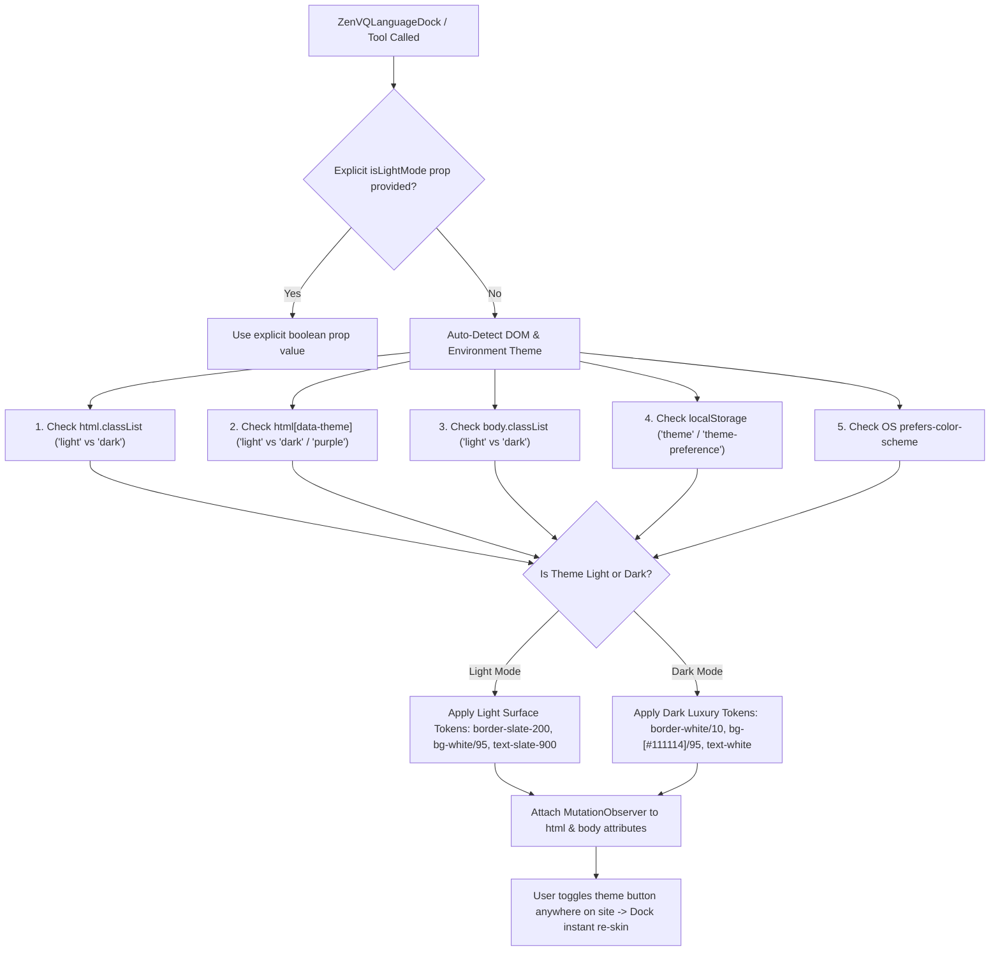

# 🌐 UNIVERSAL TRANSLATION ENGINE: MASTER TECH SPECIFICATION (A-Z)

This document provides the complete, authoritative technical specification for the **Universal Live Translation Engine & Language Dock System**. It is maintained permanently as the single canonical source of truth for all projects across the ecosystem.

---

## 1. EXECUTIVE OVERVIEW

Modern web applications often attempt translation via two flawed paradigms:
1. **Route-based locale splitting (`/en`, `/fr`, `/ar`, `/bn`):** Causes massive build artifact explosion, SSR cache duplication, routing complexity and broken relative asset links.
2. **Static JSON dictionary keys (`i18n.json`):** Leaves dynamic API data, headless CMS blocks, third-party badges and customer-generated content completely untranslated.

The **ZenVQ Live DOM Text-Node Engine (`zenvq-translate.js`)** solves both problems permanently:
- **Zero-Server Load:** Translation operations execute strictly client-edge in the visitor's browser.
- **Complete DOM Coverage:** Walks DOM text nodes directly using native browser `TreeWalker`.
- **Zero Hydration Error Architecture:** Custom patch overrides `Node.prototype.removeChild` and `insertBefore` to eliminate React 18 Virtual DOM reconciliation crashes.
- **RTL Coordinate Lock:** Strict Zero-Displacement UX law anchors navigation and dock controls regardless of document direction.
- **Sub-Millisecond Repeat Switching:** LocalStorage key-value caching provides 0ms perceived latency for previously visited translations.

---

## 2. LOW-LEVEL ENGINE MECHANICS (`zenvq-translate.js`)

### 2.1 Virtual DOM Hydration Collision Guard
React 18 fiber reconciliation tracks precise node hierarchies. When a client script replaces text node content while React unmounts or reorders elements, React may call `removeChild` on a node whose reference shifted, throwing `NotFoundError: Failed to execute 'removeChild' on 'Node'`.

The engine patches this at runtime before React mounts:
```javascript
if (typeof Node === "function" && Node.prototype) {
  const origRemoveChild = Node.prototype.removeChild;
  Node.prototype.removeChild = function (child) {
    if (child.parentNode !== this) return child;
    return origRemoveChild.apply(this, arguments);
  };
  const origInsertBefore = Node.prototype.insertBefore;
  Node.prototype.insertBefore = function (newNode, referenceNode) {
    if (referenceNode && referenceNode.parentNode !== this) {
      return origInsertBefore.apply(this, [newNode, null]);
    }
    return origInsertBefore.apply(this, arguments);
  };
}
```

### 2.2 Text-Node Traversal & Filtering
The engine initializes a native `TreeWalker` restricted to `NodeFilter.SHOW_TEXT`.
- **Excluded Tags:** `SCRIPT`, `STYLE`, `NOSCRIPT`, `CODE`, `PRE`, `SVG`, `PATH`, `TEXTAREA`, `INPUT`, `SELECT`, `OPTION`, `IFRAME` and `CANVAS`.
- **Protected Selectors:** Any element marked with `translate="no"`, `.notranslate` or `data-zenvq-ignore`.
- **Protected Regex Patterns:**
  - Phone numbers (`+1 (555) 019-2834`)
  - URLs and email addresses
  - Currencies and prices (`$4,500`, `€320`, `£80`, `¥50,000`)
  - Percentage metrics (`99.98%`, `+42%`)
  - Proprietary brand identifiers (`ZenVQ`, `ZVQP`, `zvqultra`)

### 2.3 Delimiter Chunking & Dual-Layer Network Fallback
To translate hundreds of strings rapidly without triggering rate limits:
1. Strings are packed into compact batches separated by `\n=====\n`.
2. Limit: max 8 items or max 600 characters per chunk.
3. If Google's translation response correctly preserves all delimiters, strings are assigned back in one network round-trip.
4. If delimiter mangling occurs, the engine automatically catches the mismatch and falls back gracefully to individual queries (`fetchSingleString`), ensuring zero dropped sentences.

### 2.4 MutationObserver for Dynamic Components
A persistent `MutationObserver` watches `document.body` for added child nodes or updated subtree branches.
- When an interactive dialog, dropdown menu, toast message or dynamic tab opens, the observer triggers an edge re-scan debounced at 90ms.
- Prevents infinite observer recursion via an `isMutating` gate flag.

---

## 3. ZERO-DISPLACEMENT UX LAW (RTL ANCHORING)

### The Problem
When switching to right-to-left languages (e.g. Arabic `ar` or Urdu `ur`), browsers flip the flexbox axis (`flex-direction: row-reverse`). A language switcher placed on the top-right suddenly jumps to the top-left corner of the monitor. The user, now unable to read the Arabic UI, cannot find the control to return to English.

### Mandatory Enforcement Rules
1. Every switcher component must explicitly enforce:
   `dir="ltr"` and `style={{ direction: "ltr", unicodeBidi: "isolate" }}`
2. The navbar action container housing the switcher must declare:
   `data-zenvq-nav-anchor="true"` and `dir="ltr"`
3. Standalone floating widgets must hard-lock coordinates:
   `position: fixed !important; bottom: 24px !important; right: 24px !important; left: auto !important; direction: ltr !important;`

---

## 4. THE 12 MANDATORY MARKET LANGUAGES

The 12 market languages represent the core strategic footprint across North America, Europe, the GCC and South Asia:

| Code | Language | Native Name | Script Direction | Strategic Market |
| :--- | :--- | :--- | :--- | :--- |
| `en` | English | English | `ltr` | Global Default / North America / UK |
| `bn` | Bengali | বাংলা | `ltr` | Bangladesh Hub / Regional Base |
| `ar` | Arabic | العربية | `rtl` | UAE / KSA / Middle East & GCC |
| `es` | Spanish | Español | `ltr` | USA / Spain / Latin America |
| `fr` | French | Français | `ltr` | France / Canada / EU |
| `de` | German | Deutsch | `ltr` | Germany / DACH Enterprise |
| `nl` | Dutch | Nederlands | `ltr` | Netherlands / Benelux Tech Hub |
| `it` | Italian | Italiano | `ltr` | Italy / Southern Europe |
| `pt` | Portuguese | Português | `ltr` | Portugal / Brazil |
| `hi` | Hindi | हिन्दी | `ltr` | India / South Asia |
| `ur` | Urdu | اردو | `rtl` | Pakistan / GCC Diaspora |
| `zh-CN` | Chinese | 简体中文 | `ltr` | East Asia / Greater China |

---

## 5. COMPLETE INTEGRATION MATRIX

### 5.1 Next.js App Router (Recommended)
1. Copy `zenvq-translate.js` into `/public/lib/zenvq-translate.js`.
2. In `app/layout.tsx`:
   ```tsx
   export default function RootLayout({ children }: { children: React.ReactNode }) {
     return (
       <html lang="en">
         <head>
           <script src="/lib/zenvq-translate.js" defer />
         </head>
         <body>
           {children}
         </body>
       </html>
     );
   }
   ```
3. In your Navigation Header (`Header.tsx`):
   ```tsx
   import { ZenVQLanguageDock } from "@/components/ZenVQLanguageDock";

   export function Header() {
     return (
       <header className="flex items-center justify-between px-6 py-4">
         <div className="notranslate" translate="no">ZenVQ</div>
         <nav className="flex items-center gap-4" dir="ltr" data-zenvq-nav-anchor="true">
           <ZenVQLanguageDock variant="header" theme="engineering" />
         </nav>
       </header>
     );
   }
   ```

### 5.2 Plain HTML / Static Sites / WordPress / Shopify / Webflow
Add this single snippet immediately before `</body>`:
```html
<script src="https://tools.zenvq.com/lib/zenvq-translate.js" data-auto-widget="true" defer></script>
```

---

## 6. VERIFICATION AND COMPLIANCE GATES

Every implementation must pass these 4 criteria before deployment:
1. **0ms Repeat Switch:** Switching from English to Arabic and back to English must happen instantly from cache.
2. **Stable Dock Position:** Confirm the language dock stays locked at the exact same physical screen coordinate when Arabic or Urdu is active.
3. **Protected Entity Check:** Ensure currency signs, numbers, logos and code blocks remain completely untouched.
4. **Console Cleanliness:** Zero errors or React hydration warnings in the browser console.

---

## 7. AUTOMATIC THEME DETECTION & DUAL-MODE (DARK / LIGHT) SYNCHRONIZATION

Whenever the translation tool is called across any project or page, it automatically detects and adapts to the active color theme:



### Contrast Token Specifications:
- **Dark Mode (Default):**
  - Trigger Button: `bg-white/[0.04] text-slate-300 border-white/[0.10] hover:bg-white/[0.08] hover:text-white`
  - Active Button State: `bg-white/[0.12] text-white border-white/20 shadow-sm`
  - Popover Palette: `bg-[#111114]/95 text-white border-[#27272A] shadow-[0_16px_48px_rgba(0,0,0,0.85)]`
  - Active Language Pill: `bg-white/[0.10] text-white font-semibold border border-white/[0.10]`
- **Light Mode:**
  - Trigger Button: `bg-slate-100 text-slate-700 border-slate-200 hover:bg-slate-200/80 hover:text-slate-900`
  - Active Button State: `bg-slate-200 text-slate-900 border-slate-300 shadow-sm`
  - Popover Palette: `bg-white/95 text-slate-900 border-slate-200 shadow-[0_20px_50px_rgba(15,23,42,0.14)]`
  - Active Language Pill: `bg-slate-100 text-slate-900 font-semibold border border-slate-200 shadow-xs`
